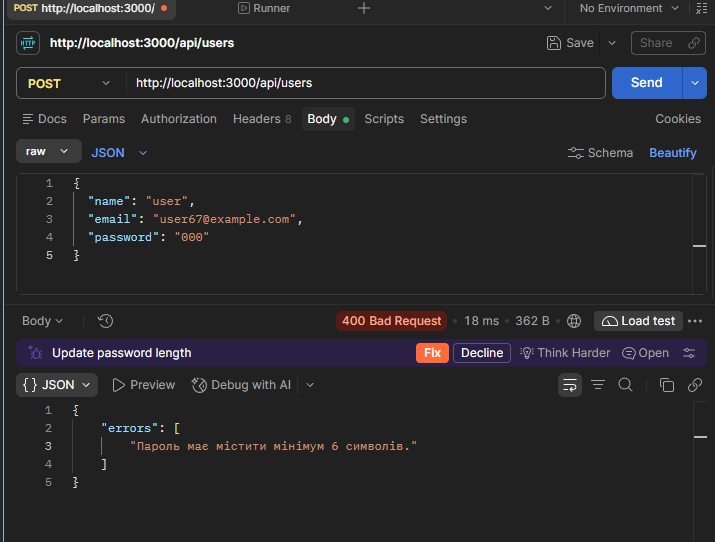
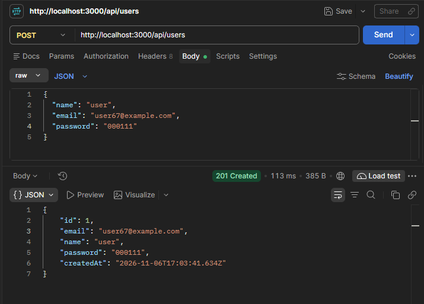
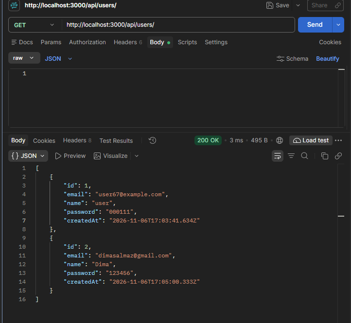
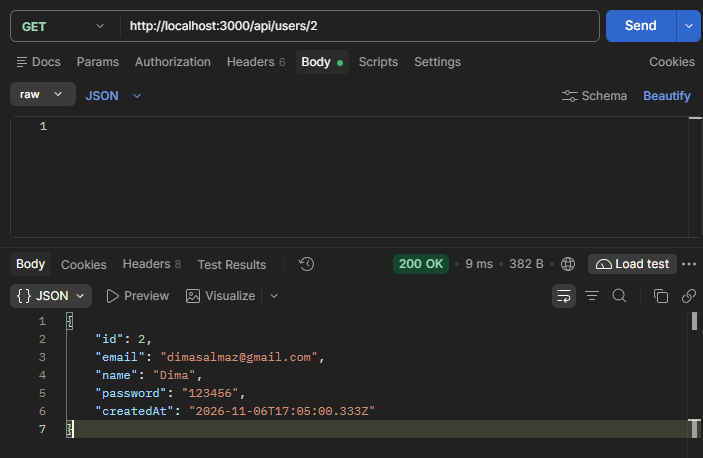
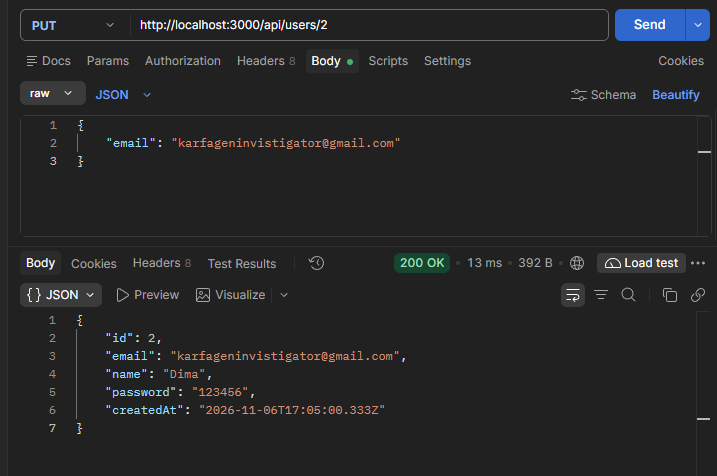
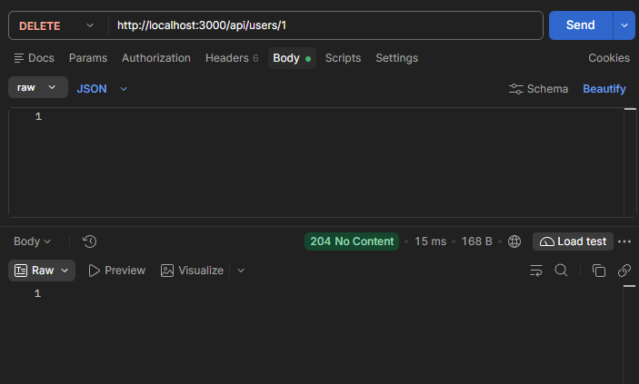

# Звіт з лабораторної роботи 1

## Тема роботи: Розроблення backend архітектури та основного функціоналу

Здобувач освіти: Поліщук Андрій Володимирович

Група: ІПЗ-42

GitHub репозиторій: https://github.com/Jaegerjaquez52/web-lab

## Предметна область: Система управління завданнями (Task Management)

## Виконання роботи

### Налаштування проєкту
- Створено Git репозиторій
- Ініціалізовано Node.js проєкт
- Встановлено необхідні залежності
- Налаштовано структуру файлів

### База даних
- Налаштовано PostgreSQL
- Створено Prisma схему
- Виконано міграції

### Backend архітектура
- Створено Express.js сервер
- Реалізовано MVC архітектуру
- Впроваджено middleware

### API endpoints

У межах ЛР1 для базового прикладу з користувачами було перевірено CRUD-маршрути. На цьому етапі вони працювали без JWT-автентифікації; автентифікацію та рольовий захист додано в наступній лабораторній роботі.

| Метод і маршрут | Призначення | Основні результати |
|---|---|---|
| `POST /api/users` | Створити користувача. У тілі запиту передаються `name`, `email`, `password`. | `201 Created` при успіху; `400 Bad Request` для невалідних даних. |
| `GET /api/users` | Отримати список користувачів. | `200 OK` зі списком. |
| `GET /api/users/:id` | Отримати користувача за ID. | `200 OK` з одним записом. |
| `PUT /api/users/:id` | Оновити дані користувача за ID. | `200 OK` з оновленим записом. |
| `DELETE /api/users/:id` | Видалити користувача за ID. | `204 No Content` при успішному видаленні. |

Цей перелік відображає саме базовий API, показаний у матеріалах ЛР1; маршрути проєктів, завдань, коментарів, файлів та автентифікації були додані або захищені на наступних етапах роботи над проєктом.

## Структура проєкту

```
_lab/
├── prisma/
│   ├── migrations/
│   └── schema.prisma
├── reports/
│   └── lab1/
│       ├──screenshots/
│       └──lab1.md
├── src/
│   ├── controllers/
│   │   └── userController.js
│   ├── models/
│   │   └── User.js
│   ├── routes/
│   │   └── userRoutes.js
│   ├── utils/
│   │   ├── prisma.js
│   │   └── validation.js
│   └── app.js
├── .env
├── .gitignore
├── package-lock.json
├── package.json
└── README.md
```

## Скріншоти тестування

### POST 





### GET 





### UPDATE 



### DELETE 



## Висновки

Самооцінка: 5

Обгрунтування: було успішно розроблено базову серверну частину  для системи управління завданнями, тестування запитів успішне, валідація працює. Структура проекту охайна, а код написайний з дотриманням всіх вимог чистого коду.