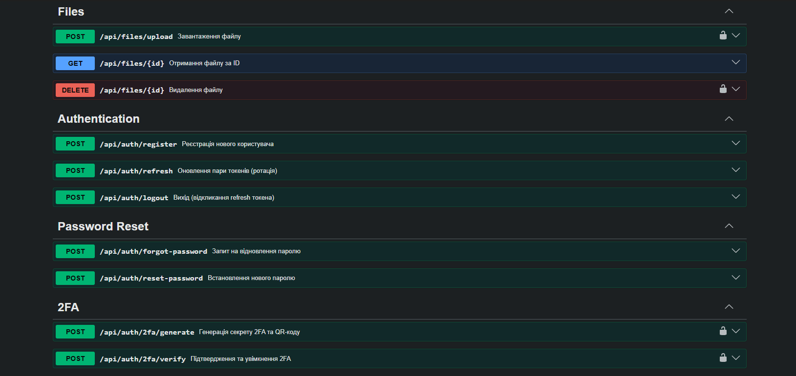
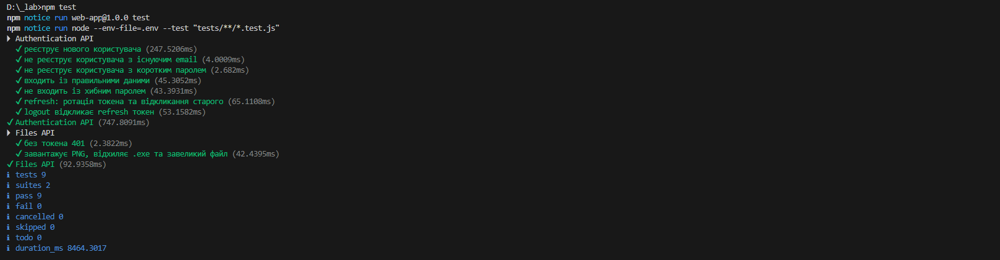

# Звіт з лабораторної роботи 2

## Тема роботи: Аутентифікація, авторизація та розширений функціонал

Здобувач освіти: Поліщук Андрій Володимирович

Група: ІПЗ - 42

GitHub репозиторій: [\[посилання\]](https://github.com/Jaegerjaquez52/web-lab)

Рівень складності: 3

## Реалізований функціонал

Під час виконання лабораторної роботи було реалізовано наступний функціонал:

- **Безпечна аутентифікація.** Впроваджено систему реєстрації та логіну з хешуванням паролів за допомогою сучасного алгоритму Argon2id.

- **JWT та управління сесіями.** Реалізовано авторизацію за допомогою короткострокових access та довгострокових refresh токенів. Впроваджено механізм ротації refresh-токенів із захистом від їх повторного/несанкціонованого використання.

- **Рольова модель (RBAC).** Створено middleware для перевірки ролей користувачів (наприклад, ADMIN, USER) та захисту окремих маршрутів від несанкціонованого доступу.

- **Файловий сервіс.** Налаштовано завантаження файлів за допомогою Multer із суворою валідацією MIME-типів, розширень та обмеженням максимального розміру. Реалізовано логіку видалення файлів.

- **Пошук, фільтрація та пагінація.** Для сутності завдань (Task) реалізовано пагінацію (page, limit), пошук за назвою/описом та фільтрацію за статусом/проєктом.

- **Документація API.** Налаштовано автоматичну генерацію інтерактивної документації за допомогою Swagger (OpenAPI 3.0).

- **Захист додатка.** Впроваджено обмеження частоти запитів (express-rate-limit) для захисту від DDoS, а також налаштовано Helmet та CORS.

- **Автоматизоване тестування.** Написано тести з використанням вбудованого node:test та supertest. Покрито 100% критичного функціоналу (9 із 9 тестів пройдено успішно).

## Ключові фрагменти коду

### 1. Механізм ротації Refresh-токенів:

```
export async function refresh(req, res) {
  // ... (валідація токена)
  const stored = await prisma.refreshToken.findUnique({
    where: { tokenHash: sha256(refreshToken) },
    include: { user: true },
  });

  if (!stored || stored.revokedAt) {
    // Якщо токен вже був відкликаний, розцінюємо це як крадіжку і блокуємо всі токени користувача!
    if (stored) {
      await prisma.refreshToken.updateMany({
        where: { userId: stored.userId, revokedAt: null },
        data: { revokedAt: new Date() },
      });
    }
    return res.status(401).json({ error: 'Недійсний refresh токен' });
  }

  // Ротація: старий токен відкликаємо, видаємо нову пару
  await prisma.refreshToken.update({
    where: { id: stored.id },
    data: { revokedAt: new Date() },
  });

  res.json({ tokens: await issueTokens(stored.user) });
}
```

### 2. Реалізація входу з підтримкою двофакторної аутентифікації (2FA):

```
  if (user.is2FAEnabled) {
    if (!twoFactorToken) {
      return res.status(403).json({ 
        error: 'Потрібна двофакторна аутентифікація',
        require2FA: true 
      });
    }
    
    const isValidToken = authenticator.verify({ token: twoFactorToken, secret: user.twoFactorSecret });
    if (!isValidToken) {
      return res.status(401).json({ error: 'Невірний код 2FA' });
    }
  }
```

### 3. Налаштування комплексного захисту сервера:
```
// Захист від відомих вразливостей через встановлення HTTP-заголовків
app.use(helmet());

// Обмеження частоти запитів (Rate Limiting) - захист від DDoS та брутфорсу
app.use(
  '/api/',
  rateLimit({
    windowMs: 15 * 60 * 1000, // 15 хвилин
    limit: Number(process.env.RATE_LIMIT) || 100, // максимум 100 запитів
    standardHeaders: 'draft-8',
    legacyHeaders: false,
    message: { error: 'Забагато запитів з цієї IP-адреси, спробуйте пізніше' },
  })
);
```

## Скріншоти

### SWAGGER



### Результати тестів



## Висновки

Самооцінка: 5

Обгрунтування: Завдання виконано в повному обсязі, включно з додатковим функціоналом підвищеної складності. Успішно реалізовано реєстрацію з хешуванням Argon2id, JWT-аутентифікацію, систему ролей, пагінацію та файловий сервіс із валідацією типів/розмірів (Multer). Впроваджено систему відновлення паролю через email, двофакторну аутентифікацію (2FA), захист від спаму запитами (Rate Limiting), налаштовано CORS та Helmet. Налаштовано безпечну ротацію refresh-токенів, написано інтеграційні тести та створено розширену документацію API у Swagger.
