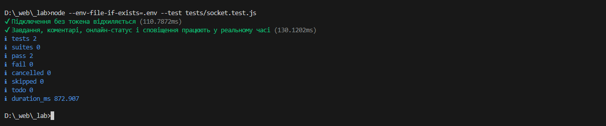
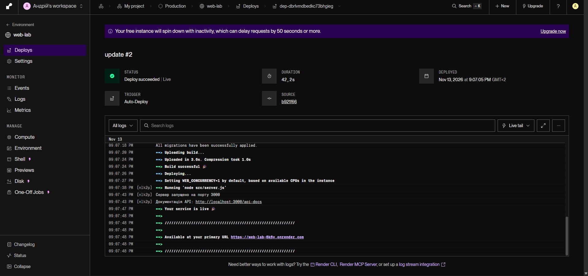

# Звіт з лабораторної роботи 03

**Тема:** Взаємодія в реальному часі та фіналізація серверної частини  
**Предметна область:** Система управління завданнями (Task Manager)

Здобувач освіти: Поліщук Андрій Володимирович

Група: ІПЗ-42
GitHub репозиторій: https://github.com/Jaegerjaquez52/web-lab

## Мета роботи

Інтегрувати обмін даними в реальному часі у backend-застосунок і перевірити його роботу разом із базовою оптимізацією запитів та автоматизованими тестами.

## Реалізований функціонал

- Socket.IO підключено до HTTP-сервера; з’єднання автентифікується JWT.
- Клієнти можуть приєднуватися лише до доступних їм кімнат проєктів і завдань. Реалізовано персональні кімнати та події онлайн-статусу.
- Події створення, оновлення й видалення завдань, а також створення й видалення коментарів передаються в реальному часі. Персональні сповіщення надсилаються користувачеві окремо.
- Події зберігаються в `RealtimeEvent`; після перепідключення клієнт може запросити пропущені події за останнім відомим ID.
- Для списків використовуються пагінація та індекси Prisma; пов’язані дані завантажуються через `include`/`select`, без циклічних запитів на кожен запис.

## Перевірка

Автоматизовані тести перевіряють автентифікацію, файлові маршрути, Socket.IO-кімнати й персональні сповіщення, а також наявність основних маршрутів у Swagger. Під час запуску `npm test` пройшли всі 12 тестів.

Фактичні результати порівняння `EXPLAIN ANALYZE` до і після індексування не збиралися, тому кількісне прискорення запитів у звіті не заявляється.

## Статус виконання

Реалізовано realtime-функціональність для основних сценаріїв завдань і коментарів та частину розширених можливостей. Розгортання на хостингу не налаштоване й не підтверджене. Redis-адаптер, Redis-кешування та горизонтальне масштабування також не реалізовані.

## Скріншоти

### 1. Виконання тестів

(1-TEST.png>)

### 2. "Демонстрація" realtime-оновлення

### 3. Розгортання на Render

###

## Самооцінка та її обґрунтування

**Самооцінка: 5**

У межах роботи реалізовано автентифіковане Socket.IO-з’єднання, контрольований доступ до кімнат, миттєву передачу змін завдань і коментарів, персональні сповіщення та інформування про онлайн-статус. Основні сценарії перевірено автоматизованими тестами. Водночас розгортання на хостингу та кількісне вимірювання продуктивності не підтверджені, тому ці результати не зараховую як виконані.
