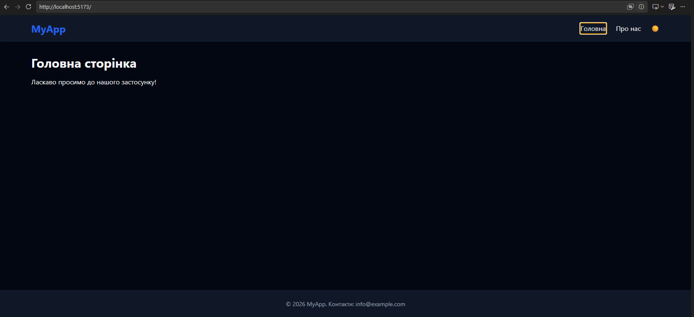
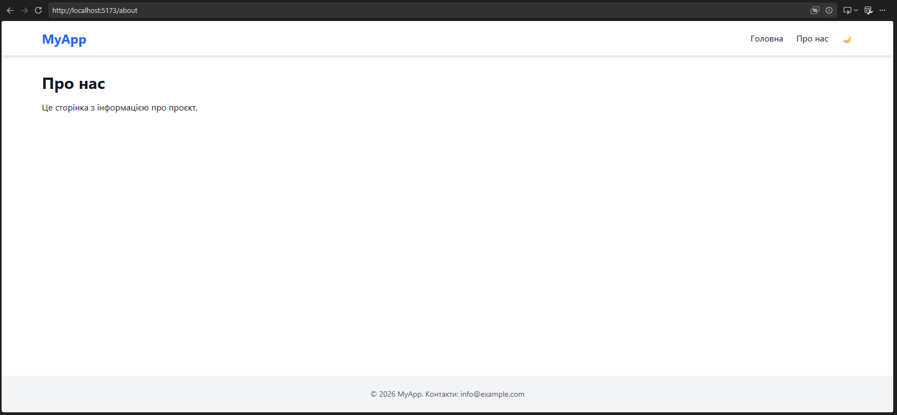

# Клієнтська частина Task Manager

## Опис проєкту
Це клієнтська частина застосунку для управління завданнями (Task Manager), розроблена в рамках лабораторної роботи №4.

## Технології
- React 19
- TypeScript
- Vite
- Tailwind CSS 4
- React Router 8
- Axios
- ESLint + Prettier

## Встановлення та запуск
### Вимоги
- Node.js 24 LTS
- npm

### Інструкції
```bash
# Встановлення залежностей
npm install

# Копіювання .env файлу
cp .env.example .env

# Запуск у режимі розробки
npm run dev

# Збірка для продакшену
npm run build
```

## Структура проєкту

```
src/
├── components/      # Повторно використовувані UI-компоненти
│   ├── common/     # Базові компоненти (Button, Input)
│   └── layout/     # Компоненти розмітки (Header, Footer)
├── hooks/          # Власні хуки React
├──   constants/      # Константи застосунку
├── pages/          # Компоненти сторінок
├── services/       # API-сервіси та налаштування Axios
├── types/          # Типи та інтерфейси TypeScript
└── utils/          # Допоміжні функції
```

## Скріншоти



